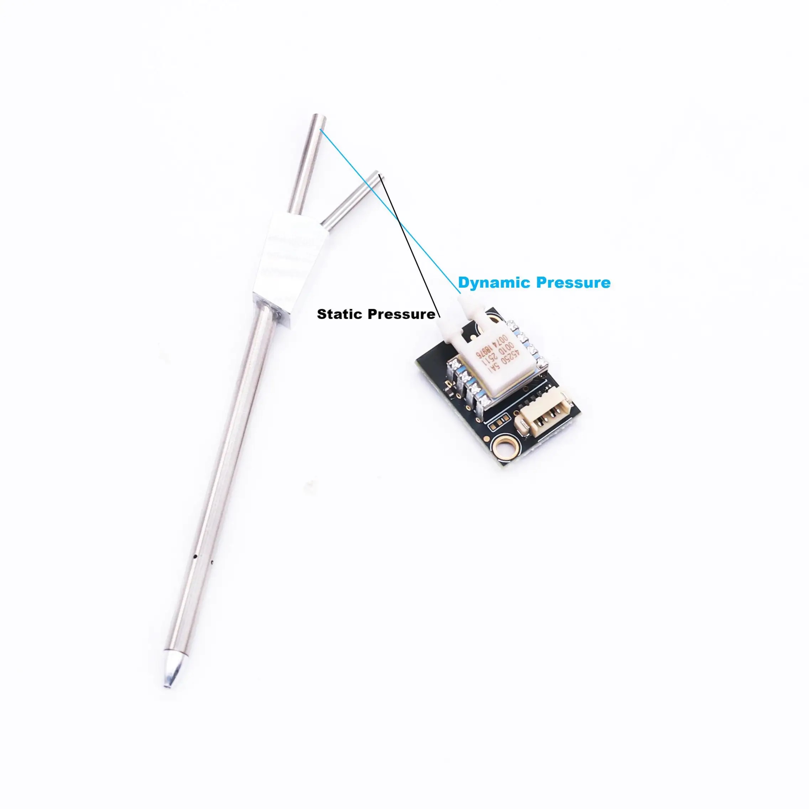
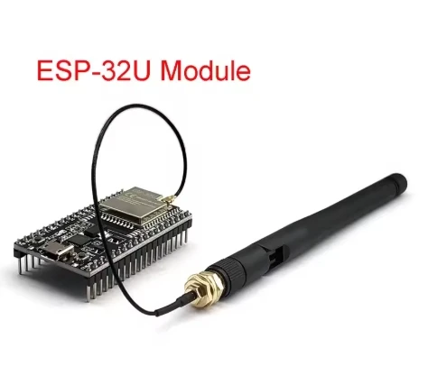
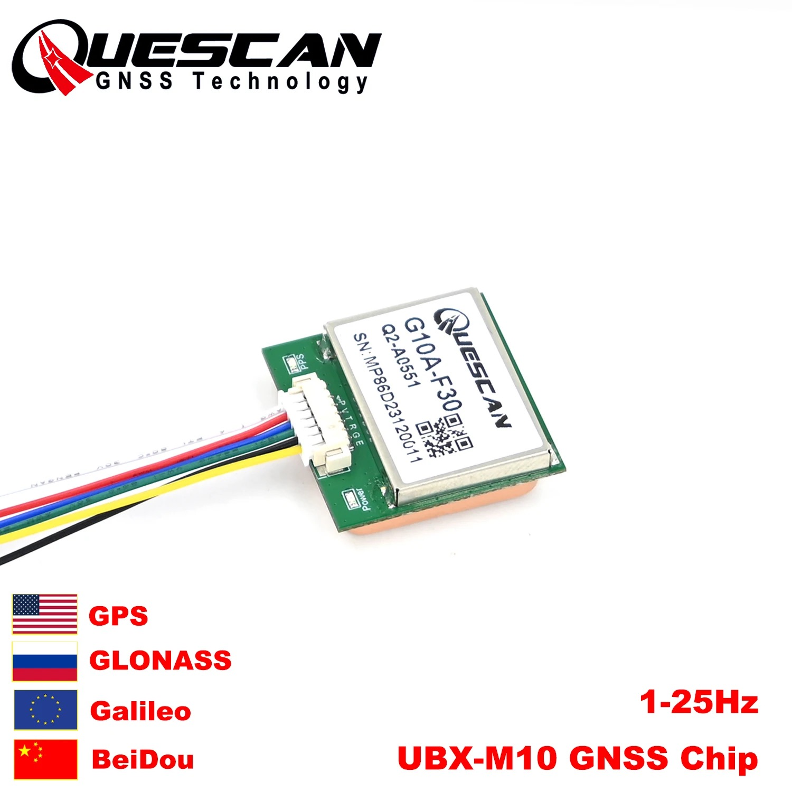
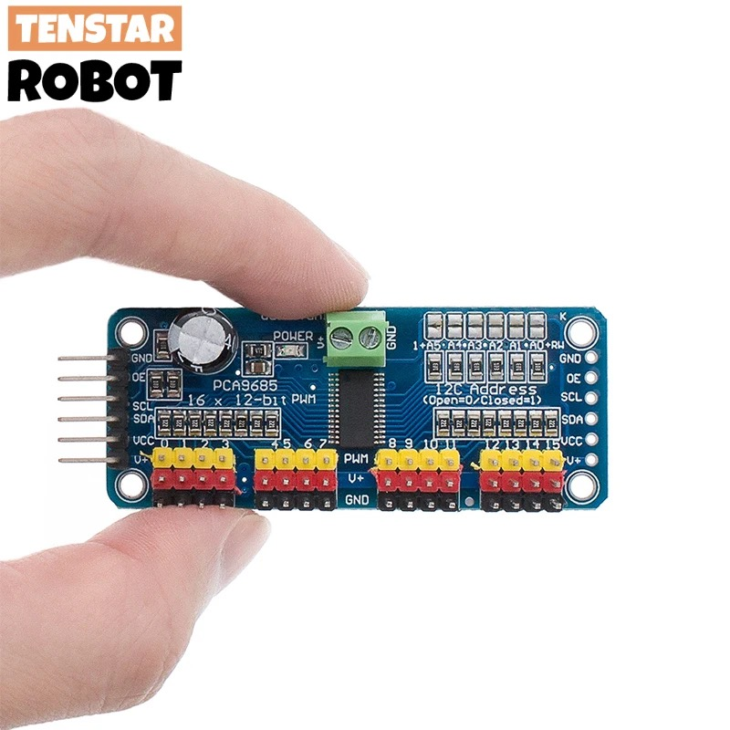
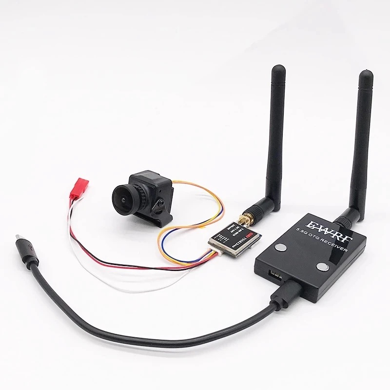
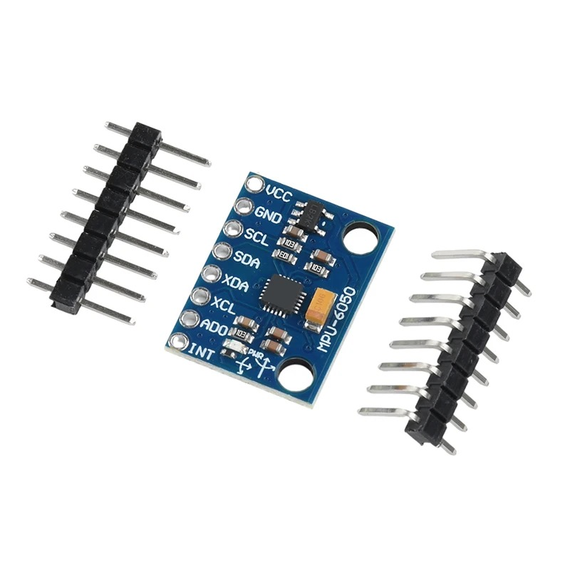
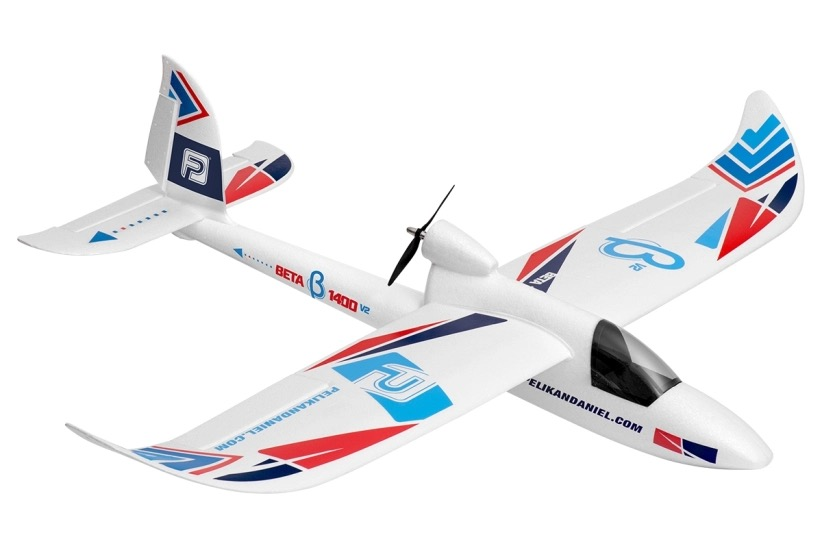
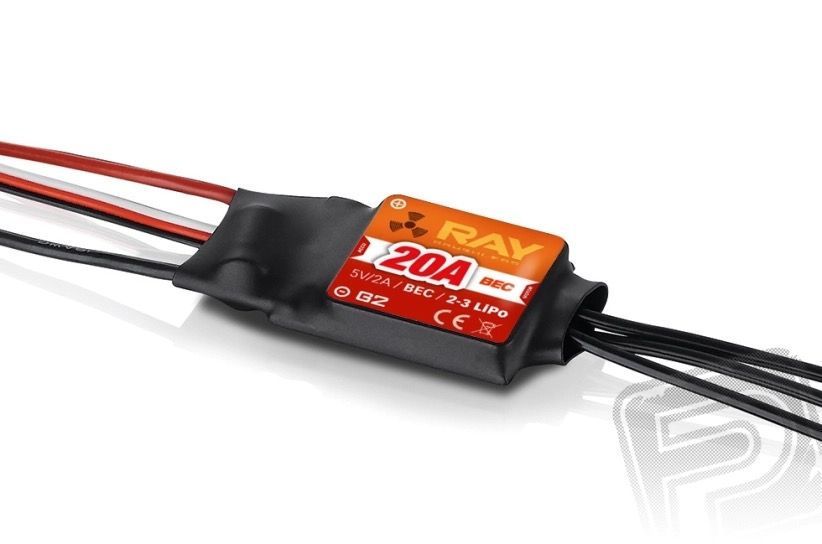
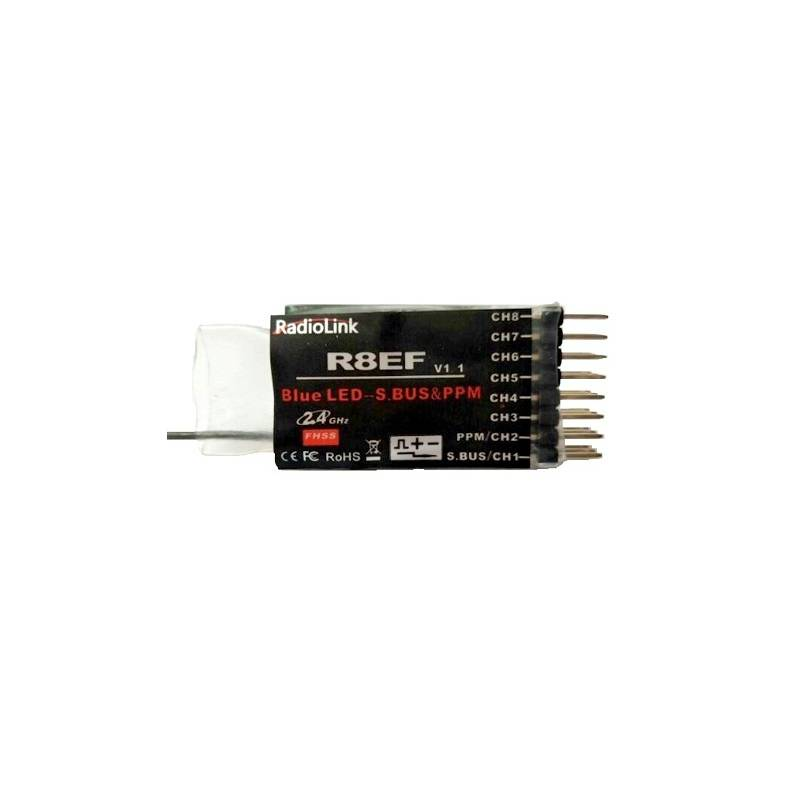
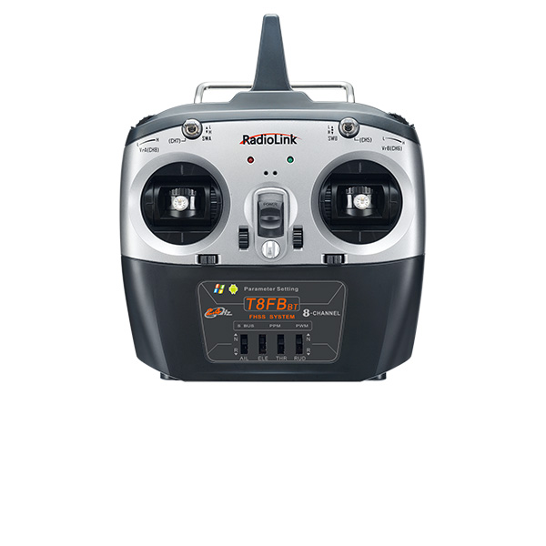

# Parts Overview

Hardware components for the airplane project — electronics ordered on AliExpress
(Jul 19, 2026), airframe and ESC from rcprofi.cz. One document per part with
full specs, pinout and wiring notes.

| Part | Doc | What it does | Interface | Key facts |
|---|---|---|---|---|
|  | [MS4525DO airspeed sensor + pitot tube](pitot-ms4525do.md) | Differential pressure → airspeed | I2C @ 0x28 (max 400 kHz), 5 V supply / 3.3 V logic, JST-GH 4-pin | ±1 psi, 14-bit, ~0–100 m/s; zero-offset cal mandatory |
|  | [ESP32 DevKitC WROOM-32U](esp32-wroom-32u.md) | MCU board — WiFi/BT, external antenna | USB (CP2102), 3.3 V logic; I2C GPIO21/22, UART2 GPIO16/17 | Dual-core LX6 @ 240 MHz, 4 MB flash; **no PCB antenna — U.FL antenna required**; 2 pcs ordered |
|  | [GY-91 10DOF IMU (MPU-9250 + BMP280)](gy91-mpu9250-bmp280.md) | Gyro + accel + compass + barometer | I2C @ 0x68 (MPU), 0x76 (BMP280), 0x0C (mag, via bypass); VIN 3–5 V | 16-bit IMU, baro ±1 m; check WHO_AM_I = 0x71 (0x70 = MPU-6500 clone without compass) |
|  | [Quescan G10A-F30 M10 GPS](gps-quescan-g10a-f30.md) | GNSS position (GPS+GLONASS+Galileo+BeiDou) | UART (3.3 V logic), NMEA/UBX | u-blox UBX-M10050-KB, ~1.5 m CEP, up to 10 Hz |
|  | [PCA9685 16-ch servo driver](pca9685-servo-driver.md) | Drives up to 16 servos over I2C | I2C @ 0x40 (default), VCC 3.3/5 V + separate V+ servo rail 5–6 V | 12-bit PWM, 50 Hz for servos; servo power from BEC, never from MCU |
|  | [5.8G FPV kit (UVC RX + VTX + camera)](fpv-58g-uvc-kit.md) | Analog video downlink to Android phone | camera CVBS → VTX 5.8 GHz → UVC dongle (OTG) | 200 mW variant, 40CH, VTX 7–24 V; ~100 ms latency; EU limit 25 mW — HAM license needed |
|  | [MPU-6050 6DOF IMU (GY-521)](mpu6050-gy521.md) — **currently wired in** | Gyro + accelerometer (no compass) | I2C @ 0x68 (AD0 → 0x69), VCC 3.3–5 V | 16-bit, onboard DMP quaternions; ⚠️ same 0x68 default as GY-91's MPU-9250 |
|  | [Beta V2 1400 M1 airframe (Pelikan)](airframe-beta-v2-1400.md) | The airplane — 1.42 m EPP trainer, RTF donor | 4 servos + brushless motor; stock RadioLink RC gets replaced by the ESP32 link | 142 cm span, 0.65–0.72 kg, 3S, C2623-1950 motor, 6×4" prop |
|  | [RAY G2 R-20B 20 A brushless ESC](esc-ray-g2-r-20b.md) | Motor drive + 5 V servo power | PWM throttle in; BEC 5 V/2 A out | 20 A (25 A burst), 2–3S; **linear** BEC — servos only, never the ESP32; motor cut 2 s after PWM loss |
|  | [RadioLink R8EF 8-ch receiver](rc-rx-radiolink-r8ef.md) — **replaced by the ESP32 link** | Stock RC receiver of the donor model, kept as fallback | SBUS + PPM + PWM out; 4.8–10 V supply | 2.4 GHz FHSS; blue LED mode: CH1 = SBUS, CH2 = PPM, CH3–8 PWM; signal level unspecified — inverter/level shifter before an ESP32 pin |
|  | [RadioLink T8FB BT 8-ch transmitter](rc-tx-radiolink-t8fb.md) — **replaced by the ESP32 link** | Stock RC transmitter of the donor model, kept as fallback | 2.4 GHz FHSS 67-ch hopping; setup via Android app/PC (no onboard UI) | Mode 1; R8EF failsafe is configured *here* (per-channel F/S); rear serial port streams live channel data (undocumented protocol) |

## Orders

| Order | Date | Item | Qty |
|---|---|---|---|
| — | Jul 19, 2026 | MS4525DO pitot kit ("For Pixhawk 6C") | 1 |
| — | Jul 19, 2026 | ESP32 WROOM-32U board + antenna ("type 1set") | 2 |
| — | Jul 19, 2026 | GY-91 module | 1 |
| — | Jul 19, 2026 | Quescan G10A-F30 GPS | 1 |
| — | Mar 20, 2023 | 5.8G FPV kit, "200mW version" | 1 |
| — | Jan 7, 2026 | MPU-6050 module (diymore) | 1 |

## Wiring quick reference (all sensors on one ESP32)

All I2C devices sit **in parallel on one shared bus**: every SDA pin goes to
GPIO21, every SCL pin to GPIO22. No address conflicts (0x28 / 0x68 / 0x76 /
0x0C / 0x40).

| Device | Interface | Device pin → ESP32 pin | Address(es) | Power |
|---|---|---|---|---|
| MS4525DO | I2C | SDA → GPIO21, SCL → GPIO22 | 0x28 | 5 V → VCC |
| GY-91 | I2C | SDA → GPIO21, SCL → GPIO22; NCS, CSB, SDO/SAO unconnected | 0x68 (MPU) + 0x76 (BMP280); 0x0C (mag, after bypass) | 5 V → VIN |
| PCA9685 | I2C | SDA → GPIO21, SCL → GPIO22 | 0x40 | 5 V → VCC (servo rail V+ separate — see below) |
| GPS — **currently wired in** | UART2 | TX → GPIO16 (RX2), RX → GPIO17 (TX2); PPS, EN unconnected | — | 5 V → VCC (onboard LDO; TX/RX stay 3.3 V logic) |

Common ground for everything.

⚠️ Exception: the **MPU-6050 (currently wired in)** and the GY-91's MPU-9250 both default to **0x68** — when both are connected, pull AD0/SAO high on one of them (→ 0x69).

## Power distribution (3S Li-ion pack)

Pack: 3S Li-ion, 9.0–12.6 V (nominal ~10.8 V). Buck (switching) converters for the 5 V rails — no linear regulators from pack voltage (a linear reg from 11 V to 5 V wastes ~55% as heat; a buck is 90%+ efficient). The video chain takes pack voltage directly (see below).

```
3S Li-ion (9–12.6 V)
 │
 ├── BUCK A — PSM module (e.g. iFlight BLITZ PSM BXN, 2–8S in, 5V/2A + 12V/3A out)
 │     ├─ 5 V/2 A  → ESP32 (VIN pin), MS4525DO, GY-91, MPU-6050, GPS, PCA9685 VCC
 │     │             (electronics peak ~0.6 A → plenty of headroom)
 │     (PSM 12 V rail unused — VTX + camera go direct from the pack; measured:
 │      any converter in front of them *raises* battery draw, see below)
 │
 └── BUCK B — servo UBEC 5–6 V / ≥5 A (e.g. Hobbywing/Matek 5A class)
       └─ PCA9685 V+ screw terminal (+ 470–1000 µF electrolytic on V+/GND)
```

### Sizing & rules

| Branch | Load | Peak current | Converter |
|---|---|---|---|
| Electronics 5 V | ESP32 + all sensors + PCA9685 logic | ~0.6 A | PSM 5 V/2 A |
| Video | VTX 200 mW + camera | 312 mA @ 12 V (measured) | direct from pack |
| Servos | PCA9685 V+ | **~1 A per loaded 9g servo**, more at stall (4 servos → budget 4–5 A) | dedicated UBEC ≥5 A |

- **Servos must have their own converter** — a servo stall transient on a shared rail brown-outs the ESP32.
- **Never feed pack voltage (11 V) into ESP32 VIN** — the onboard AMS1117 would dissipate >1 W and thermally shut down. Always go through a 5 V buck first.
- Common ground for all branches, star topology from the pack.
- UVC FPV receiver is ground-side (powered by the phone) — nothing needed onboard.
- VTX + camera are a **constant-power load** (internal switching regulators) — measured 312 mA @ 12 V direct vs 350 mA through a Mini-360 at 7.5 V, i.e. a step-down converter only adds its own loss and heat. Power them straight from the pack; VTX heatsink heat is RF PA dissipation and needs airflow, not a lower voltage. Details in `architecture.md` (Power architecture).
- Full-throttle motor showed no video interference with direct pack feed (bench test). If noise bands ever appear after airframe installation, the fix is an LC filter (~100 µH + 470 µF) in front of the VTX — not a converter.

### Battery monitoring

**Per-cell** monitoring via the balance connector is implemented in firmware
(`esp32/src/air/battery.cpp`, plan + full divider analysis in
`doc/plans/2026-08-10-battery-cell-monitoring.md`): three dividers from the
3S balance leads to ADC1 input-only pins — C1 10k/10k → GPIO35, C2 28k/10k
→ GPIO34, C3 56k/10k → GPIO39, 100 nF at each pin, all nodes under the 11 dB
attenuation's ~2.45 V linear ceiling. Cells come from subtracting the
cumulative node voltages; telemetry carries `cellMv[3]` + `TELEM_FLAG_BATT_OK`
and the HUD shows a `BAT` line bottom-right. Li-ion discharge curve is flat —
the actionable signals are the hard floor of ~3.0 V/cell and a cell diverging
from its siblings (HUD blinks below 3.2 V/cell or Δ > 150 mV). The sense
harness (Y-tap off the balance lead) is built and verified end-to-end; the
per-channel constants in `battery.cpp` carry a one-point scale calibration
(full pack vs multimeter, 2026-08-23) and zero offsets — the second point on
a near-empty pack is still to be measured.

### Shopping list (not yet ordered)

- 1× iFlight BLITZ PSM BXN 2–8S, 5V/2A + 12V/3A ([AliExpress 1005006108885165](https://www.aliexpress.com/item/1005006108885165.html))
- 1× servo UBEC 5–6 V / 5 A (2–6S input)
