# Parts Overview

Hardware components for the airplane project — electronics ordered on AliExpress
(Jul 19, 2026), airframe and ESC from rcprofi.cz. One document per part with
full specs, pinout and wiring notes.

| Part | Doc | What it does | Interface | Key facts |
|---|---|---|---|---|
| 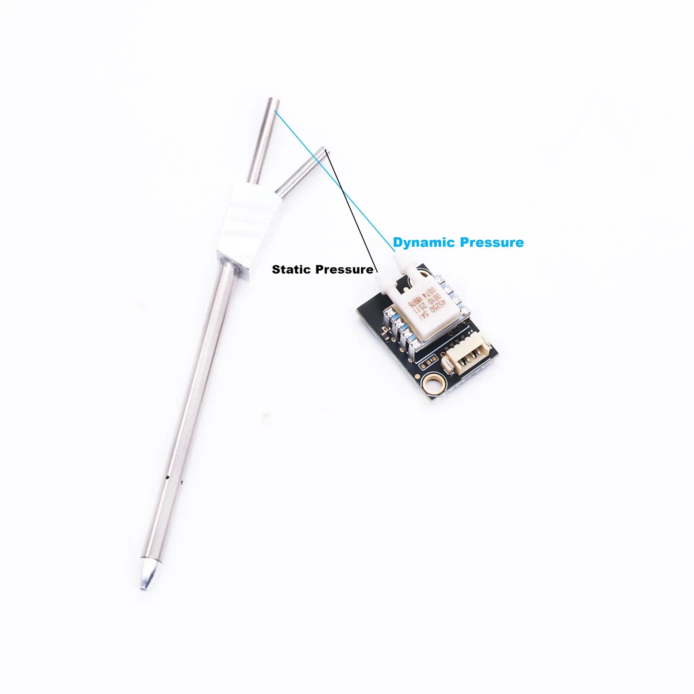 | [MS4525DO airspeed sensor + pitot tube](pitot-ms4525do.md) | Differential pressure → airspeed | I2C @ 0x28 (max 400 kHz), 5 V supply / 3.3 V logic, JST-GH 4-pin | ±1 psi, 14-bit, ~0–100 m/s; zero-offset cal mandatory |
| 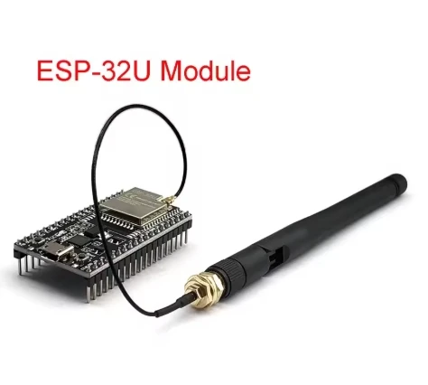 | [ESP32 DevKitC WROOM-32U](esp32-wroom-32u.md) | MCU board — WiFi/BT, external antenna | USB (CP2102), 3.3 V logic; I2C GPIO21/22, UART2 GPIO16/17 | Dual-core LX6 @ 240 MHz, 4 MB flash; **no PCB antenna — U.FL antenna required**; 2 pcs ordered |
| 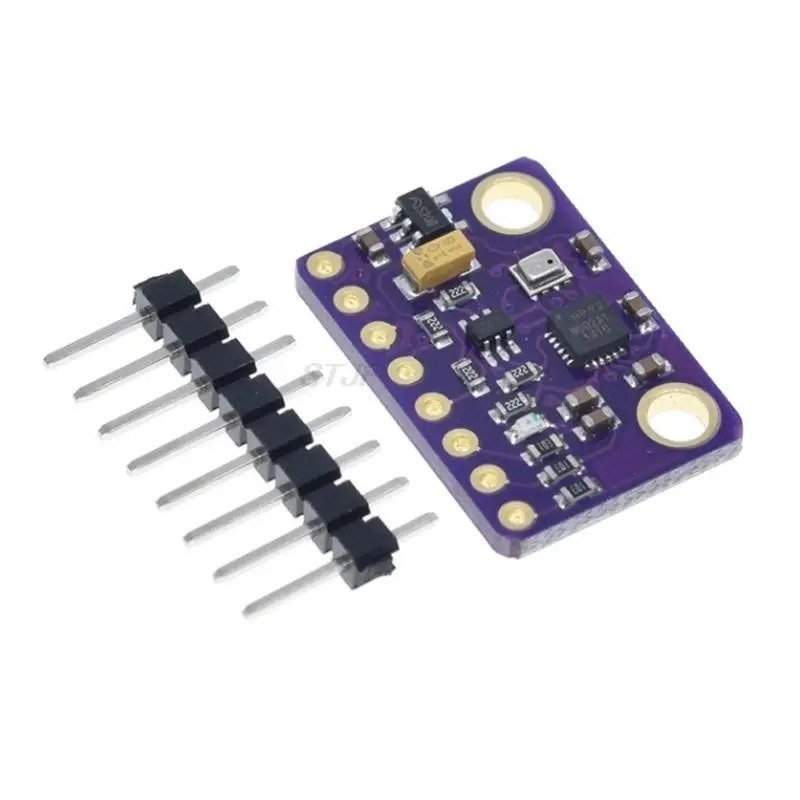 | [GY-91 10DOF IMU (MPU-9250 + BMP280)](gy91-mpu9250-bmp280.md) | Gyro + accel + compass + barometer | I2C @ 0x68 (MPU), 0x76 (BMP280), 0x0C (mag, via bypass); VIN 3–5 V | 16-bit IMU, baro ±1 m; check WHO_AM_I = 0x71 (0x70 = MPU-6500 clone without compass) |
| 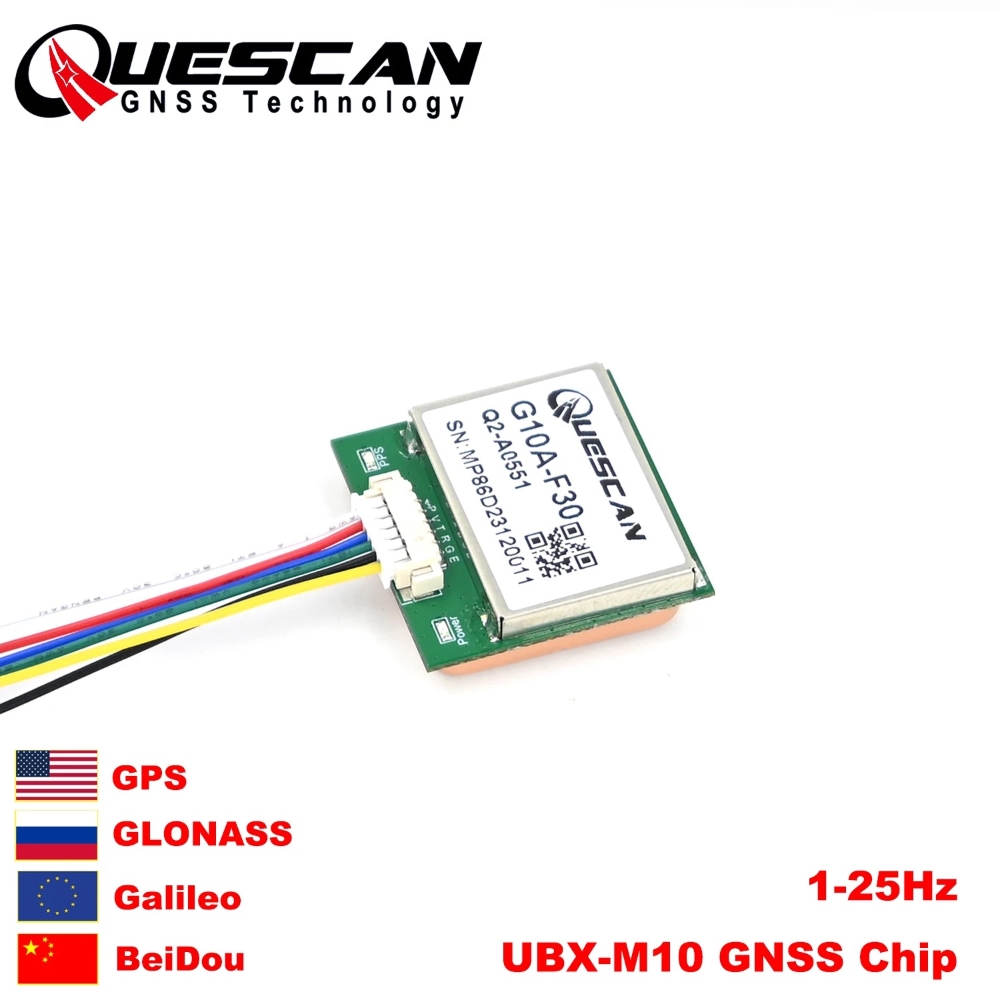 | [Quescan G10A-F30 M10 GPS](gps-quescan-g10a-f30.md) | GNSS position (GPS+GLONASS+Galileo+BeiDou) | UART (3.3 V logic), NMEA/UBX | u-blox UBX-M10050-KB, ~1.5 m CEP, up to 10 Hz |
| 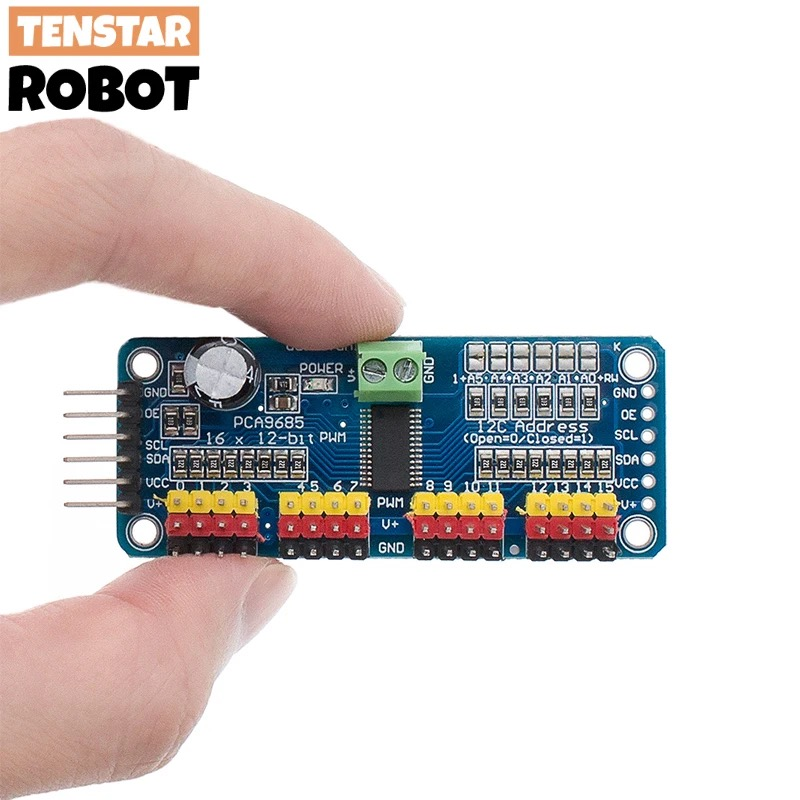 | [PCA9685 16-ch servo driver](pca9685-servo-driver.md) | Drives up to 16 servos over I2C | I2C @ 0x40 (default), VCC 3.3/5 V + separate V+ servo rail 5–6 V | 12-bit PWM, 50 Hz for servos; servo power from BEC, never from MCU |
| 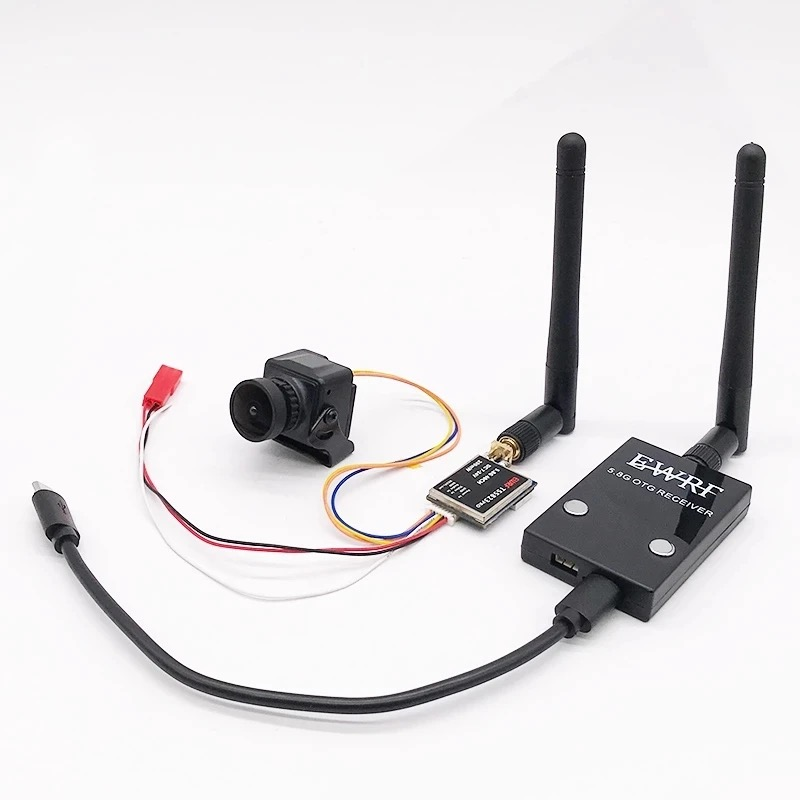 | [5.8G FPV kit (UVC RX + VTX + camera)](fpv-58g-uvc-kit.md) | Analog video downlink to Android phone | camera CVBS → VTX 5.8 GHz → UVC dongle (OTG) | 200 mW variant, 40CH, VTX 7–24 V; EU limit 25 mW — HAM license needed. VTX died 2026-10-20 (hot-plug), replaced by ULTRA 1600 (7–36 V, 25 mW step, works since 2026-10-25) — §9; latency ~100 ms with the TS5823, ~200 ms with the ULTRA 1600 (§6, unexplained) |
| 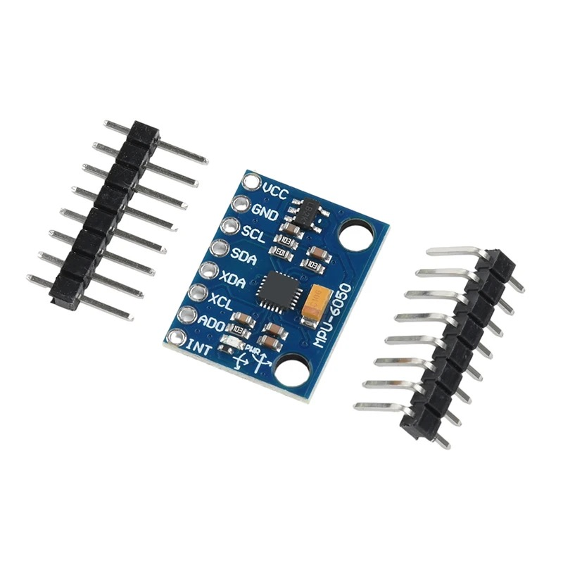 | [MPU-6050 6DOF IMU (GY-521)](mpu6050-gy521.md) — **currently wired in** | Gyro + accelerometer (no compass) | I2C @ 0x68 (AD0 → 0x69), VCC 3.3–5 V | 16-bit, onboard DMP quaternions; ⚠️ same 0x68 default as GY-91's MPU-9250 |
| 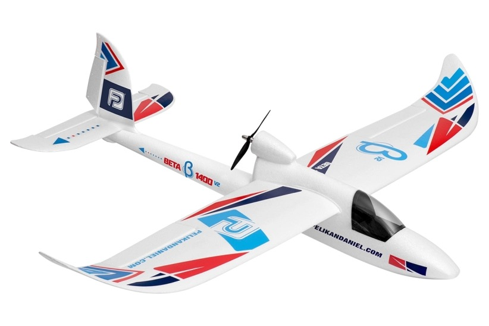 | [Beta V2 1400 M1 airframe (Pelikan)](airframe-beta-v2-1400.md) | The airplane — 1.42 m EPP trainer, RTF donor | 4 servos + brushless motor; stock RadioLink RC gets replaced by the ESP32 link | 142 cm span, 0.65–0.72 kg, 3S, C2623-1950 motor, 6×4" prop |
| 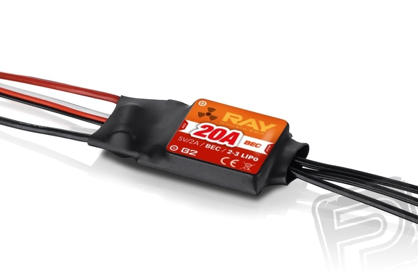 | [RAY G2 R-20B 20 A brushless ESC](esc-ray-g2-r-20b.md) | Motor drive + 5 V servo power | PWM throttle in; BEC 5 V/2 A out | 20 A (25 A burst), 2–3S; **linear** BEC — servos only, never the ESP32; motor cut 2 s after PWM loss |
| — | [Samsung INR18650-30Q 3S Li-ion pack](battery-samsung-30q.md) | The flight battery — 3S1P, 3000 mAh | XT60 + 3S JST-XH balance lead | 12.6 V full, 15 A continuous per cell, **unprotected**; land at 3.5 V/cell resting, never below 3.0 V |
| 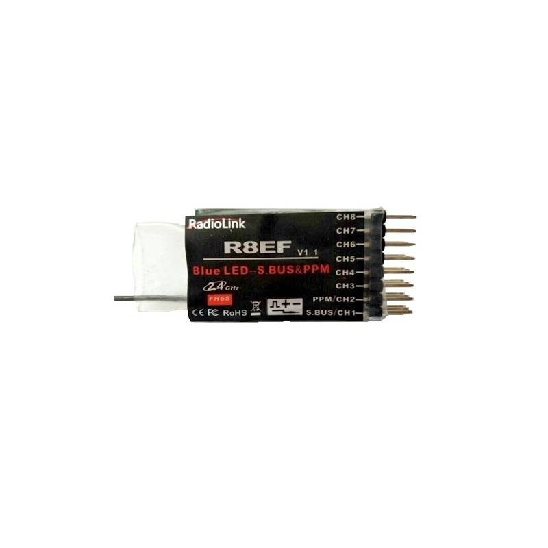 | [RadioLink R8EF 8-ch receiver](rc-rx-radiolink-r8ef.md) — **replaced by the ESP32 link** | Stock RC receiver of the donor model, kept as fallback | SBUS + PPM + PWM out; 4.8–10 V supply | 2.4 GHz FHSS; blue LED mode: CH1 = SBUS, CH2 = PPM, CH3–8 PWM; signal level unspecified — inverter/level shifter before an ESP32 pin |
| 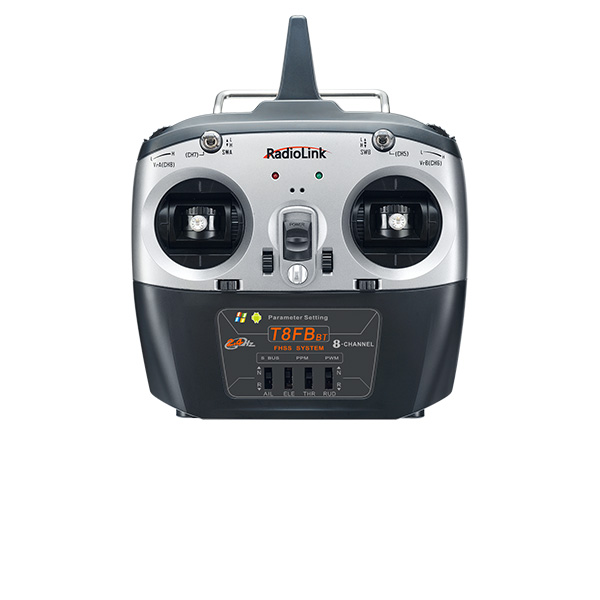 | [RadioLink T8FB BT 8-ch transmitter](rc-tx-radiolink-t8fb.md) — **replaced by the ESP32 link** | Stock RC transmitter of the donor model, kept as fallback | 2.4 GHz FHSS 67-ch hopping; setup via Android app/PC (no onboard UI) | Mode 1; R8EF failsafe is configured *here* (per-channel F/S); rear serial port streams live channel data (undocumented protocol) |

## Orders

| Date | Item | Qty |
|---|---|---|
| Jul 19, 2026 | MS4525DO pitot kit ("For Pixhawk 6C") | 1 |
| Jul 19, 2026 | ESP32 WROOM-32U board + antenna ("type 1set") | 2 |
| Jul 19, 2026 | GY-91 module | 1 |
| Jul 19, 2026 | Quescan G10A-F30 GPS | 1 |
| Mar 20, 2023 | 5.8G FPV kit, "200mW version" | 1 |
| Jan 7, 2026 | MPU-6050 module (diymore) | 1 |

## Wiring quick reference (all sensors on one ESP32)

All I2C devices sit **in parallel on one shared bus**: every SDA pin goes to
GPIO21, every SCL pin to GPIO22. No address conflicts (0x28 / 0x68 / 0x76 /
0x0C / 0x40).

| Device | Interface | Device pin → ESP32 pin | Address(es) | Power |
|---|---|---|---|---|
| MS4525DO | I2C | SDA → GPIO21, SCL → GPIO22 | 0x28 | sensor rail → VCC (4.65 V, see below) |
| GY-91 | I2C | SDA → GPIO21, SCL → GPIO22; NCS, CSB, SDO/SAO unconnected | 0x68 (MPU) + 0x76 (BMP280); 0x0C (mag, after bypass) | sensor rail → VIN (onboard LDO) |
| PCA9685 | I2C | SDA → GPIO21, SCL → GPIO22 | 0x40 | 5 V → VCC (servo rail V+ separate — see below) |
| GPS — **currently wired in** | UART2 | TX → GPIO16 (RX2), RX → GPIO17 (TX2); PPS, EN unconnected | — | sensor rail → VCC (onboard LDO; TX/RX stay 3.3 V logic) |

Common ground for everything.

⚠️ Exception: the **MPU-6050 (currently wired in)** and the GY-91's MPU-9250 both default to **0x68** — when both are connected, pull AD0/SAO high on one of them (→ 0x69).

## Power distribution (3S Li-ion pack)

Pack: **3S1P [Samsung INR18650-30Q](battery-samsung-30q.md)**, 12.6 V full / ~11.1 V nominal, 3000 mAh (~33 Wh). The 9.0 V lower bound quoted below is the absolute floor, not a flight target — land at 3.5 V/cell resting (10.5 V); see that doc for the discharge limits and the full-throttle sag. Buck (switching) converters for the 5 V rails — no linear regulators from pack voltage (a linear reg from 11 V to 5 V wastes ~55% as heat; a buck is 90%+ efficient). The video chain takes pack voltage directly (see below).

```
3S Li-ion (9–12.6 V)
 │
 ├── BUCK A — LaskaKit mini SMD step-down, 5 V fixed (LA122016B, MP1584
 │   │         clone, 1.8 A, 6–26 V in) — **puts out 5.3 V**, not adjustable
 │   ├─ 5.3 V → ESP32 (5V/VIN pin; the onboard AMS1117 is happy up to 15 V)
 │   └─ 1N4004 in series → sensor rail **4.65 V** under its ~50 mA load
 │        → MS4525DO VCC, GY-91 VIN, GPS VCC (later: PCA9685 VCC)
 │          (electronics peak ~0.6 A → plenty of headroom)
 │   (VTX + camera go direct from the pack; measured: any converter in
 │    front of them *raises* battery draw, see below)
 │
 └── BUCK B — servo UBEC 5–6 V / ≥5 A (e.g. Hobbywing/Matek 5A class)
       └─ PCA9685 V+ screw terminal (+ 470–1000 µF electrolytic on V+/GND)
```

### Sizing & rules

| Branch | Load | Peak current | Converter |
|---|---|---|---|
| Electronics 5 V | ESP32 + all sensors + PCA9685 logic | ~0.6 A | LaskaKit 5 V / 1.8 A (5.3 V actual) |
| Video | VTX 200 mW + camera | 312 mA @ 12 V (measured) | direct from pack |
| Servos | PCA9685 V+ | **~1 A per loaded 9g servo**, more at stall (4 servos → budget 4–5 A) | dedicated UBEC ≥5 A |

- **Servos must have their own converter** — a servo stall transient on a shared rail brown-outs the ESP32.
- **The logic buck delivers 5.3 V and that is what the ESP32 gets.** It is a
  fixed-output module (measured under load, 2026-11-04), fine for everything
  with an LDO behind the pin — but the MS4525DO sits on the rail directly and
  its absolute maximum is 5.5 V: 0.2 V of margin is less than a cheap buck's
  load-step overshoot. Hence the **series diode on the common sensor supply
  wire**: a 1N4004 for now, 0.65 V at the ~50 mA the three sensors draw
  (GPS ~40, GY-91 ~5, pitot ~3.5), giving 4.65 V. Each device's limit:

  | Device | Supply path | Limit | At 5.3 V | At 4.65 V |
  |---|---|---|---|---|
  | MS4525DO | chip VDD directly, 5.0 V nominal | abs. max 5.5 V | legal, no margin | 7 % under nominal, zero recalibrated at every boot |
  | GY-91 | onboard 3.3 V LDO, spec VIN 3–5 V | LDO input ~6 V | fine | 1.3 V above dropout |
  | GPS Quescan | onboard 3.3 V LDO, spec 3.3–5.0 V | LDO input ~6 V | above the seller's spec, fine | fine |
  | ESP32 devkit 5V pin | AMS1117-3.3 | 15 V in | fine (more headroom) | — (not behind the diode) |
  | PCA9685 (future) | VCC 2.3–5.5 V | 5.5 V | fine, planned on 3V3 anyway | fine |

  **To do: swap the 1N4004 for a Schottky (1N5819 / BAT85)** — ~0.35 V at
  50 mA gives ~4.95 V, i.e. the pitot's nominal. Same place, band toward the
  sensors. Do not put the ESP32 behind the diode (its radio bursts would
  modulate the drop) and do not put more loads on it than the sensors.
  A 5.1 V Zener (1N5231B) is the wrong part here: it needs a series resistor
  and sits well below 5.1 V at these currents.
- **Never feed pack voltage (11 V) into ESP32 VIN** — the onboard AMS1117 would dissipate >1 W and thermally shut down. Always go through a 5 V buck first.
- Common ground for all branches, star topology from the pack.
- UVC FPV receiver is ground-side (powered by the phone) — nothing needed onboard.
- VTX + camera are a **constant-power load** (internal switching regulators) — measured 312 mA @ 12 V direct vs 350 mA through a Mini-360 at 7.5 V, i.e. a step-down converter only adds its own loss and heat. Power them straight from the pack; VTX heatsink heat is RF PA dissipation and needs airflow, not a lower voltage. Details in `architecture.md` (Power architecture).
- Full-throttle motor showed no video interference with direct pack feed (bench test). If noise bands ever appear after airframe installation, the fix is an LC filter (~100 µH + 470 µF) in front of the VTX — not a converter.
- **The pack connector is the only hot-plug point.** The VTX's input buck is rated 24 V with a 26 V absolute maximum and no TVS; plugging it onto a live pack rings the input toward 2 × V_in and killed one (2026-10-20, `fpv-58g-uvc-kit.md` §8). Everything stays wired to the distribution board, only the pack gets plugged.
- The camera is powered from the VTX's camera header (5–12 V, ~70 mA), not from the pack directly.

### Battery monitoring

**Per-cell** monitoring via the balance connector is implemented in firmware
(`esp32/src/air/battery.cpp`, plan + full divider analysis in
`doc/plans/2026-08-10-battery-cell-monitoring.md`): three dividers from the
3S balance leads to ADC1 input-only pins — C1 10k/10k → GPIO35, C2 28k/10k
→ GPIO34, C3 56k/10k → GPIO39, 100 nF at each pin, all nodes under the 11 dB
attenuation's ~2.45 V linear ceiling. Cells come from subtracting the
cumulative node voltages; telemetry carries `cellMv[3]` + `TELEM_FLAG_BATT_OK`
and the HUD shows a `BAT` line bottom-right. Li-ion discharge curve is flat —
the actionable signals are the hard floor of ~3.0 V/cell and a cell diverging
from its siblings (HUD blinks below 3.2 V/cell or Δ > 150 mV). The sense
harness (Y-tap off the balance lead) is built and verified end-to-end; the
per-channel constants in `battery.cpp` carry a one-point scale calibration
(full pack vs multimeter, 2026-08-23) and zero offsets — the second point on
a discharged pack is still to be measured, planned after the first real
flight. See [the pack's own doc](battery-samsung-30q.md) for what that
measurement needs, and for the ~0.3 V/cell full-throttle sag that makes the
3.2 V alarm fire with a quarter of the pack still left.

### Shopping list (not yet ordered)

- 1× Schottky diode 1N5819 or BAT85 — replaces the 1N4004 on the sensor rail (see above)
- 1× servo UBEC 5–6 V / 5 A (2–6S input)
