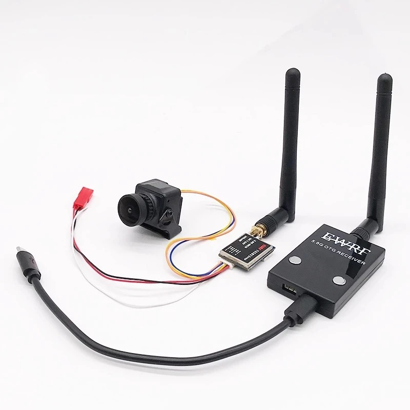
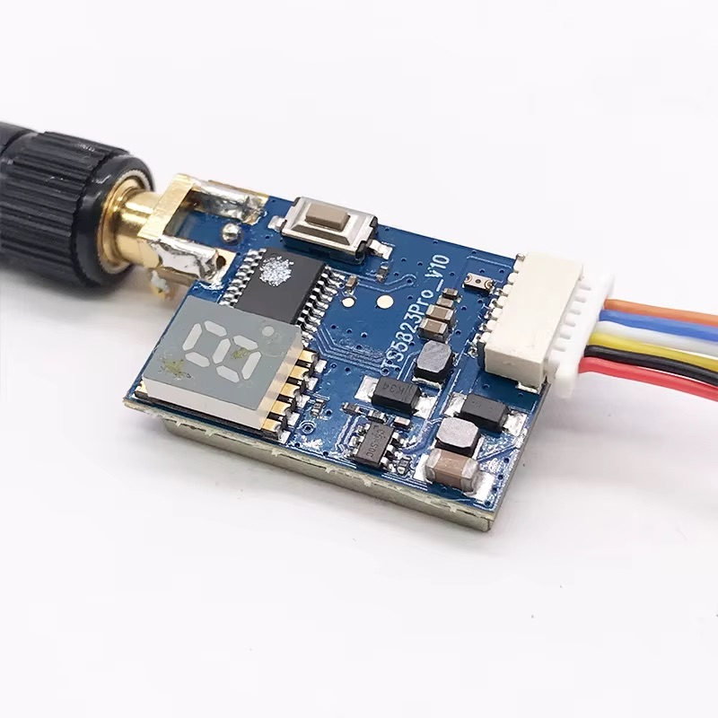
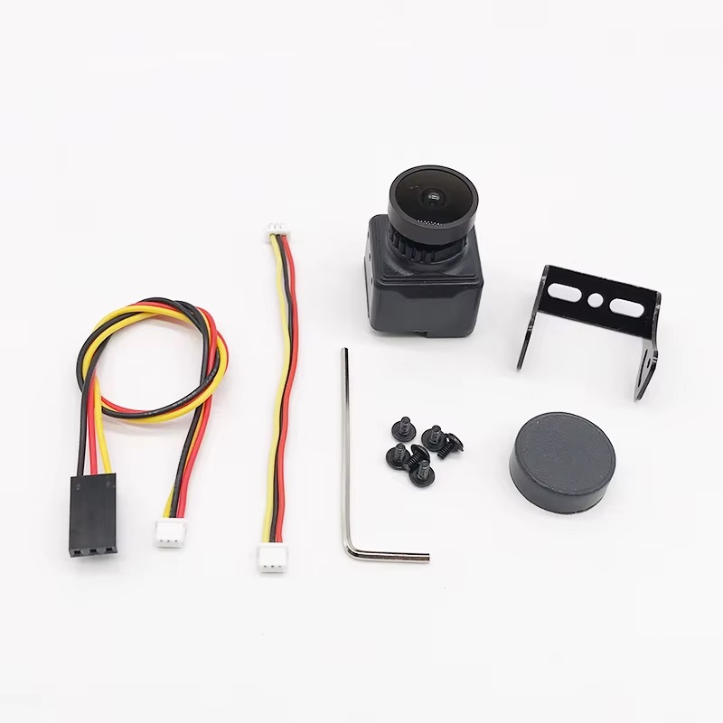

# 5.8 GHz Analog FPV Kit — UVC Receiver + VTX + Camera



- **Ordered:** 1× variant **"200mW version"** (AliExpress, Mar 2023)
- **Product:** [Ready to Use 5.8G FPV UVC Receiver + 200/600mW Transmitter + CMOS 1200TVL Camera](https://www.aliexpress.com/item/1005004766486947.html) — RC Market Store
- **What it is:** complete analog FPV chain: mini CVBS camera → 5.8 GHz video transmitter (TS58xx family) → UVC receiver dongle (ROTG01 class) that plugs into an Android phone via OTG
- **Brand / models (seller sheet, 2026-10-21):** the whole kit is **EWRF**-branded — receiver "EWRF 5.8G OTG RECEIVER", VTX **EWRF TS5823** (board silkscreen `TS5823Pro_V10`), camera "1200TVL Mini Camera". Box contents: receiver + 5 dBi whip, VTX + 2 dBi whip, camera with tilt bracket, lens cap, screws and hex key, two 3-pin camera leads (JST↔JST and JST↔servo-style Dupont), the VTX's 6-pin JST pigtail, and two OTG cables (micro-USB↔micro-USB, micro-USB↔USB-C).

## 1. UVC receiver dongle (ROTG01 class)

| Parameter | Value |
|---|---|
| RF | 5.8 GHz, 5645–5945 MHz, **150 channels** (bands A/B/E/F/R + low), sensitivity −90 dBm |
| Output | UVC (standard webcam device); digitized **640×480 @ 25–30 fps** |
| Power | from phone, ~200 mA @ 5 V |
| Android | OTG plug-and-play; apps: **Go FPV**, UVC FPV, RotG (DVR recording, VR split-screen) |
| PC | works as a normal UVC webcam (VLC, OBS) |
| iOS | **not supported** |
| Antenna | **RP-SMA** jack (same as the VTX — the two whips are interchangeable), ~5 dBi whip included |
| Button | short press = next channel; **long press = auto-search** (locks strongest signal) |

## 2. Video transmitter (TS5823-family, 200 mW variant)

| Parameter | Value |
|---|---|
| RF | 5.8 GHz, **40 CH** (5 bands × 8: A/B/E/F/R), FM analog |
| Output power | **200 mW (~23 dBm)** — this ordered variant; 600 mW version exists |
| Supply | **DC 7–24 V** (2S–4S LiPo direct; 3S recommended) — NOT the 5 V whoop type. The 24 V is the input buck's own rating with no margin (abs. max 26 V, see §8) |
| Current | seller sheet at 12 V: **150 mA @ 200 mW, 230 mA @ 600 mW** — measured with camera: see §5 |
| Video in | CVBS 0.8–1.2 Vp-p / 75 Ω, PAL & NTSC transparent |
| Antenna | **RP-SMA** jack (outer thread, centre *pin*) with a ~2 dBi whip (RP-SMA plug: knurled nut, centre *socket*). A true SMA jack (centre socket) threads onto this whip but makes no centre contact — a replacement VTX with an "MMCX–SMA" pigtail needs an MMCX–RP-SMA pigtail or an SMA antenna |
| Channel select | one push-button + a single 7-segment digit showing band letter / channel number (table below) |
| Connector | 6-pin JST pigtail, order as printed on the shield: **Power in, GND, Video in, Audio in, GND, DC5V out** — the camera runs from the VTX's own 5 V buck, not from the pack |
| Size/weight | 30×20×8 mm without the antenna mount, 5 g (seller sheet) |



Frequency table as printed by the seller ([image](img/fpv-58g-vtx-spec.jpg)); the
board's digit shows the letter in the first column, which maps onto the usual
band names as noted:

| Digit | Band | CH1 | CH2 | CH3 | CH4 | CH5 | CH6 | CH7 | CH8 |
|---|---|---|---|---|---|---|---|---|---|
| A | A (Boscam A) | 5865 | 5845 | 5825 | 5805 | 5785 | 5765 | 5745 | 5725 |
| b | B (Boscam B) | 5733 | 5752 | 5771 | 5790 | 5809 | 5828 | 5847 | 5866 |
| C | E (Boscam E) | 5705 | 5685 | 5665 | 5645 | 5885 | 5905 | 5925 | 5945 |
| d | F (FatShark / IRC) | 5740 | 5760 | 5780 | 5800 | 5820 | 5840 | 5860 | 5880 |
| E | R (Raceband) | 5658 | 5695 | 5732 | 5769 | 5806 | 5843 | 5880 | 5917 |

All in MHz. The receiver covers 5645–5945 MHz, so every row is reachable; its
auto-search finds the channel, the table only matters when setting the VTX
by hand.

⚠️ **Never power up without the antenna attached** — can destroy the PA stage. The 600 mW boards overheat without airflow; at 200 mW heating is milder but still mount with airflow (confirmed by buyer reviews).

## 3. Camera (generic "1200TVL" mini CMOS)



Seller's sheet (2026-10-21) unless noted:

| Parameter | Value |
|---|---|
| Sensor | 1/3" color CMOS; PAL 976H×582V, NTSC 976H×494V effective pixels |
| Real resolution | the sheet itself says **1000TVL** horizontal; "1200TVL" is the listing name. Analog CVBS tops out ~500–600 TVL and the UVC dongle resamples to 640×480 anyway |
| Output | CVBS 1.0 Vp-p / 75 Ω, PAL (NTSC optional per SKU), internal sync |
| Image processing | AGC 4 levels (0.25/0.50/0.75/1.00, max 55 dB), WB on/off, electronic shutter 1/50 (1/60) – 1/100000 s, gamma 0.45/1.0 — none of it user-accessible (no OSD/menu) |
| Lens / FOV | sheet offers **2.5 mm / 130°** or **2.8 mm / 120°**; which one shipped is not recorded (an earlier note here said 2.1 mm / 125°, not from the sheet) — read the lens barrel |
| Supply | **DC 5–12 V** (seller: measured to 13 V), 70 mA — fed from the VTX's camera header, not from the pack directly. Measured 66 mA at 4.3 V (2026-10-21). A full 3S pack (12.6 V) sits at the top of its range |
| Operating temp. | −20 … +60 °C |
| Connector | 3-pin JST (VCC, GND, video); the kit's JST↔JST lead goes to the VTX camera header, the JST↔Dupont lead is for a separate supply / recorder |
| Size/weight | 22×22 mm, ~12 g with bracket |

## 4. Wiring

```
3S pack (9–12.6 V) ── power distribution board ──┬─ DC/DC 5 V → ESP32 & co.
                                                 └─ VTX VCC (7–24 V) + GND
VTX camera header (6-pin ribbon) → camera VCC + GND + video-in
VTX antenna: RP-SMA whip — ALWAYS attach before power-up
```

The camera hangs on the VTX's `DC5V out` pin, i.e. on the output of the
VTX's internal buck (shield label). That is also why it saw the pack
voltage when that buck's switch shorted (§8).

**One connection point only.** The VTX stays permanently wired to the
distribution board and the pack connector is the only thing that gets
plugged in or out. Never connect or disconnect the VTX while the pack is
live — that killed one (§8). If a separately pluggable VTX is ever needed,
put a 220 µF/25 V electrolytic (ordinary ESR — it is the damper) plus an
SMBJ15A TVS right at the VTX input.

Ground side: receiver dongle → OTG cable → Android phone (Go FPV app), or USB → PC as webcam. No pairing — power the VTX, long-press the RX button to auto-search.

## 5. Power draw — measured (Aug 2026)

- Whole chain (camera + 200 mW VTX) straight from a 3S pack: **312 mA @ 12 V
  ≈ 3.7 W**. Against the seller sheet (150 mA @ 200 mW, 230 mA @ 600 mW, plus
  70 mA camera) that is 90 mA above the 200 mW figure and 12 mA above the
  600 mW one — either the sheet is optimistic or the unit runs at 600 mW
  despite the "200mW version" order. Not resolved; a replacement unit should
  be measured alone (no camera) before it is trusted.
- The chain is a **constant-power load** — the VTX derives its internal rails
  with switching regulators, not a linear one. Verified by feeding it through
  a Mini-360 buck at 7.5 V: battery draw *rose* to 350 mA @ 12 V (the ~0.45 W
  difference is the converter's own loss, and the module runs warm).
  **Do not put a step-down converter in front of it** — power camera and VTX
  directly from the pack.
- The VTX heatsink heat is RF power-amplifier dissipation (~25–35 % PA
  efficiency → roughly 1–1.5 W of heat at 200 mW out) and does not depend on
  supply voltage. Mount with airflow; a lower rail changes nothing.
- Motor at full throttle produced no visible interference in the video,
  with or without the buck (bench test — recheck once installed in the
  airframe).

## 6. Latency

- Pure analog chain (camera → VTX → RX): < 40 ms. The VTX is plain FM
  modulation with no frame buffer, so swapping it cannot move this number.
- UVC digitization + USB + Android rendering adds ~50–100 ms → **~100 ms
  glass-to-glass** (seen with the TS5823)
- Fine for line-of-sight/camera-plane use; not for proximity/racing flying
- **Measured with the ULTRA 1600: 0.20 s glass-to-glass** (2026-10-25,
  viewer = cocpitView on the PC; FPV camera pointed at a phone running a
  stopwatch, phone held next to the monitor, both photographed in one frame).
  The earlier ~100 ms was measured the same way but possibly with a different
  viewer app, so the two numbers may not be comparable. The VTX itself cannot
  be the cause (plain FM, no frame buffer, CVBS has no resolution to choose);
  the only signal-side change is the live audio subcarrier from the ULTRA
  1600's built-in microphone, which a viewer might buffer against for A/V
  sync. **Parked** — 200 ms is fine for line-of-sight flying; if it ever
  matters, first remeasure with audio disabled in the viewer.

## 7. Legal note (CZ/EU)

License-free 5.8 GHz analog video is limited to **25 mW EIRP** (ERC Rec 70-03). Both 200 mW and 600 mW settings **exceed the limit** — transmitting legally requires a HAM (amateur radio) license, and these generic VTXs have no valid CE/RED certification. Use accordingly (low power indoors/test bench, or get the license).

## 8. Failure 2026-10-20 — input buck destroyed by hot-plug

The VTX died the first time it was plugged **onto an already live pack**
(the DC/DC for the ESP32 was running). Every earlier session had connected
the pack to the distribution board with the VTX already wired, and that
worked for over a year. Same wiring, no reverse polarity; the chip
vaporized on contact.

**What burned:** the SOT-23-6 controller of the first of two identical
step-down cells on the board (`TS5823Pro_V10`; each cell = SOT-23-6 IC +
SS34/SK34 Schottky + shielded inductor + input tantalum — an asynchronous
buck). The intact unit carries a Richtek-style top mark (`D0S=93`, the `=`
is Richtek's format); the exact code could not be resolved (Richtek does
not publish marking tables), but the circuit matches the Richtek
RT8258/RT8259 class: 4.5–24 V in, 1.2 A, **absolute maximum VIN 26 V**,
pinout 1 BOOT, 2 GND, 3 FB (0.8 V ref), 4 EN, 5 VIN, 6 PHASE. Both parts
are EOL.

**Why it died:** a stiff source (pack node held low-impedance by the ESP
buck's charged input capacitors) plus the VTX's short lead and ceramic
input caps make an undamped LC edge that rings toward 2 × V_in — 24–25 V
from a full pack — against a 26 V absolute maximum with no TVS on the
board. Plugging the pack into the whole harness instead puts the ESP
buck's electrolytic on the same node and damps the ring. The "7–24 V" on
the box is the chip's rating, not a margin.

**Collateral:** the camera survived (66 mA at 4.3 V, spec 70 mA), which is
consistent with it seeing the pack voltage through the shorted high-side
switch and tolerating 13 V. Whether anything behind the dead buck (second
buck, MCU, RF) survived is unknown until tested.

**Repair options, in order of preference:**

1. Replace the SOT-23-6 (new RT8259 or a pin-compatible part with a higher
   rating — verify pinout against the board: pin 5 to the input cap, pin 6
   to the Schottky cathode + inductor, pin 1 via a small ceramic to PHASE).
   Check the Schottky and inductor of that cell first.
2. Bypass the cell: remove the dead IC, read the rail voltage off the FB
   divider (`Vout = 0.8 × (1 + R_top/R_bottom)`), ohm-check the output node
   to GND, then feed it from a current-limited bench supply to prove the
   rest of the board lives. If it does, a small MP1584/Mini-360 module next
   to the VTX, set to that rail and fed from the pack, replaces the cell
   (it replaces, not cascades, so the constant-power argument in §5 does
   not apply). Sharing the ESP32's 5 V rail is a bench test only — video
   would share digital supply and ground.
3. New module, protected by the single-connection-point rule above.

## 9. Replacement VTX — ULTRA 1600 (chosen 2026-10-21, Rotorama)

Chosen over a second TS5823 after the §8 failure. Verified against the
seller page and the manufacturer's manual (`ULTRA1600`, scanned PDF, linked
in Sources). **Arrived and works on the bench (2026-10-25)**; the only
surprise is the video latency, see §6.

| Parameter | ULTRA 1600 | TS5823 (for comparison) |
|---|---|---|
| Supply | **7–36 V** (2–8S) — 2 × V_in of a full 3S pack is 25 V, well inside | 7–24 V, 26 V abs. max |
| Power levels | Pit / **25** / 200 / 400 / 800 / 1600 mW (board print; the shop page omits 200) | 200 or 600 mW |
| Bands | A, B, E, FatShark, Raceband + Boscam D, Low Race, Boscam X (4990–5621 MHz, **outside the receiver's 5645–5945 MHz** — do not use) | A/B/E/F/R |
| Camera supply | **5 V / 0.6 A BEC** on the connector, "just for a camera / cooling fan" — never feed the pack into it | DC5V out |
| Control | one button + 3 LEDs (channel blue, band green, power red; hold 2 s to enter, short press to step), plus **IRC Tramp** on the `IRC` pin (single-wire UART — the ESP32 could switch pit/25 mW on the ground later) | button + 7-seg |
| Antenna | **MMCX** on board; shop pigtail is MMCX–SMA, so a **TrueRC MMCX→RP-SMA 90° 10 cm** pigtail goes in the order instead to keep RP-SMA everywhere | RP-SMA |
| Size / weight | 36.5 × 36.5 × 12 mm, 30.5 mm holes, 15 g, aluminium heatsink, thermal protection | 30 × 20 × 8 mm, 5 g |
| Connector | 6-pin JST: **DC, GND, GND, +5V, IRC, VIDEO** (board print); loose lead included | 6-pin JST |
| Current | not published — measure alone (no camera) at 25 and 200 mW once installed | 150 / 230 mA @ 12 V |

Wiring: camera `VCC` → `+5V`, `GND` → `GND`, video → `VIDEO`, spliced from
the camera's JST↔Dupont lead. The single-connection-point rule (§4) still
applies, the margin is just much larger.

**Antennas:** 2 × FlyfishRC Osprey 150 mm **RP-SMA LHCP** (2.8 dBi,
5.6–6 GHz, VSWR < 1.2, 11.3 g, RG141 semi-rigid stalk, polycarbonate cap).
Both ends circular with the same sense — a CP antenna on one side only costs
3 dB against a linear whip. Mounting on the airframe: stalk along the belly,
element 45° back/down behind the trailing edge, ≥ 5 cm from battery, ESC
leads and the carbon wing tube (EPP itself is transparent at 5.8 GHz); as
far from the ESP32 antenna and the GPS as the fuselage allows, then check
`LNK` and the satellite count against a session without the VTX. The RP-SMA
bulkhead needs a small plywood/plastic plate glued into the EPP. Overhead
null: both antennas have a minimum along their axis, so a plane straight
above sits in both — tilting either antenna 30–45° moves it; at ≤ 200 m
overhead the 1/r² gain covers it anyway. The old whips stay as spares (all
RP-SMA). The FlyfishRC Osprey Stubby (23 mm, 4.2 g, 5.6–5.9 GHz) is the
fallback if the 150 mm proves too exposed on landings.

Legal: 25 mW is the only EU-legal step (§7), and EIRP counts the antenna
gain — with 2.8 dBi the 25 mW step is ~48 mW EIRP, so strictly still over.

### IRC Tramp control line (measured and wired 2026-10-25; firmware: `doc/todo/003`)

The `IRC` pin is a single-wire half-duplex UART (9600 8N1, 16-byte frames:
`0x0F`, command, payload, checksum, `0x00`; commands `r`/`v`/`s` query
range/status/temperature, `F`/`P`/`I` set frequency/power/pit mode, the VTX
answers on the same wire). Measured on the pack-powered module: **3.59 V
idle, 0.31 V under a 1 kΩ load to GND → input with a ~10 kΩ pull-up to a
3.6 V rail**, so the VTX logic is 3.6 V, not 5 V. 3.59 V sits at the ESP32's
absolute-maximum input (VDD + 0.3 V), hence the series resistor on RX.

```
VTX JST pin IRC ──┬──[ 10 kΩ ]── ESP32 GPIO26  (UART1 RX)
                  │
                  └──[ 1 kΩ ]─── ESP32 GPIO27  (UART1 TX)
GND is common via the pack; no extra wire needed
```

- The 1 kΩ in the TX leg makes the shared line collision-safe: a VTX low
  against an idle-high ESP32 TX sinks ~3 mA instead of shorting two
  outputs, and an ESP32 low pulls the line to ~0.3 V against the 10 kΩ
  pull-up. Keep TX ≤ 1 kΩ for that reason. The 10 kΩ in the RX leg limits
  any clamp-diode current to microamps; at 9600 baud the RC is negligible.
- GPIO26/27 are free (21/22 I2C, 16/17 GPS, 34/35/39 battery ADC, 1/3 USB
  console); UART1 must be remapped off the flash pins anyway:
  `Serial1.begin(9600, SERIAL_8N1, 26, 27)`.
- Firmware must discard its own 16-byte echo on RX before reading the reply.
- On USB-only bench power the ESP32 TX feeds ~3 mA through the 1 kΩ into
  the unpowered VTX pin — harmless, which is the other job of that resistor.
- A signal wire does not touch the single-connection-point rule (§4): the
  VTX stays permanently wired, only the pack connector is ever plugged.
- Payoff: pit / 25 mW on the ground and power or channel changes from
  cocpitView over the command link, plus VTX temperature in telemetry
  (the module has thermal protection — this would show how close it runs).

### Thermal behaviour and pit mode (measured 2026-11-06, bench, still air)

Module loose on the bench, antenna on, no airflow, ~22 °C room; temperature
is the Tramp `s` readback (logged by the air firmware, plan step 5):

| state | equilibrium | notes |
|---|---|---|
| pit mode | < 59 °C, still falling | cools ~7 °C/min from 73 °C |
| 25 mW | **63 °C** | the idle state on the ground |
| 800 mW | **~75 °C** | 63 → 74 °C in 4.9 min, τ ≈ 2.2 min; stays under the 85 °C HUD alarm |
| 1600 mW | **~88 °C** | 74 → 87 °C in 7 min; the HUD alarm blinks from 85 °C; **no self-throttling** seen (actual stayed 1600 mW), so the module's own protection sits above 88 °C |

Cooling after 7 min at 1600 mW: 87 → 78 °C in 100 s at 25 mW, 73 → 63 °C
in 90 s in pit mode. The alarm clears ~30 s after stepping down. These
are worst-case numbers: the VTX is mounted on the **outside** of the
airframe in the slipstream, so in flight every step runs cooler; on the
ground before takeoff (no wind, sun) the bench applies — hence 25 mW or
pit on the ground, higher steps only airborne. The heatsink's only
contact with the EPP is the glued face (EPP softens above ~100 °C; use a
heat-stable adhesive, not hot-melt).

**Pit mode range ≈ 30 cm** on the configured channel (the receiver loses
the picture at 2 m) — weak RF, not RF off and not a separate pit
frequency. The module reports its configured power in both `v` power
fields while in pit mode, so the pit RF level itself is not readable.

Seen once in 20 min: a `v` request echo with its trailing `0x00` garbled
to `0x1E` — the VTX began its reply while the ESP32's last byte was still
on the wire. The 1 kΩ series resistor turns such a collision into one
corrupted byte instead of two outputs fighting; the driver drops the
frame and the next poll repairs it.

## Sources

- [Eachine ROTG01 receiver](https://www.eachine.com/Eachine-ROTG01-UVC-OTG-5.8G-150CH-Full-Channel-FPV-Receiver-For-Android-Mobile-Phone-Smartphone-p-843.html)
- [USB OTG FPV receivers overview (BrushlessWhoop)](https://brushlesswhoop.com/usb-otg-fpv-receivers/)
- [TS5823 200 mW VTX review (Oscar Liang)](https://oscarliang.com/ts5823-200mw-video-transmitter/)
- [Foxtech TS5828 spec](https://dev.foxtechfpv.com/58g-600mw-48channel-vtx.html)
- [Rotorama — ULTRA 25-1600mW 4.9-5.8G](https://www.rotorama.cz/product/ultra-4-9g-5-8g-1600mw) and its [manual](https://www.rotorama.cz/assets/docs/a7592742784194b3b7ad265245b01827/27274-1/1600.pdf)
- [Rotorama — FlyfishRC Osprey 150 mm RHCP/LHCP](https://www.rotorama.cz/product/osprey-150mm-rhcp-lhcp?variant=880)
- [VTX power limits by country](https://blog.uavmodel.com/vtx-power-limits-by-country-fcc-ce-and-international-fpv-compliance-2026-guide/)
