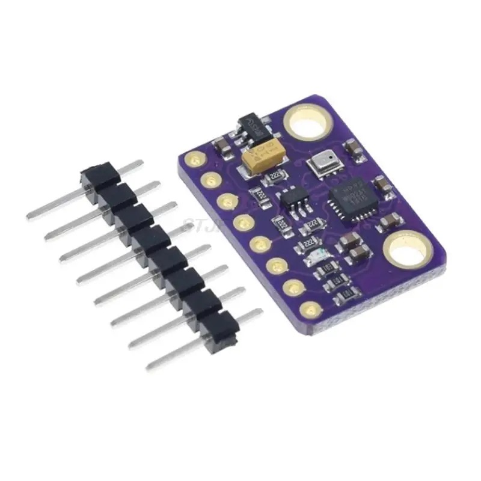

# GY-91 — 10DOF IMU Module (MPU-9250 + BMP280)



- **Ordered:** 1×, AliExpress (Jul 19, 2026)
- **Product:** [MPU9250 BMP280 10DOF Acceleration Gyroscope Compass Nine Shaft Sensor Module GY-91](https://www.aliexpress.com/item/1005005777372325.html) — Global IC Distributor Store
- **What it is:** 9-axis IMU (3-axis gyro + accel + AK8963 magnetometer) + barometer, ~14.3×20.5 mm, 8 pins @ 2.54 mm
- Onboard 3.3 V LDO (**VIN accepts 3–5 V**), onboard I2C pull-ups (~10 kΩ), 3.3 V logic

## MPU-9250 specs (TDK InvenSense)

| Parameter | Value |
|---|---|
| Gyro | ±250/500/1000/2000 dps, 16-bit, ODR up to 8 kHz |
| Accelerometer | ±2/4/8/16 g, 16-bit, ODR up to 4 kHz |
| Magnetometer (AK8963) | ±4800 µT, 14/16-bit, 8/100 Hz continuous |
| I2C | up to 400 kHz; address **0x68** (SAO low) / 0x69 (SAO high) |
| SPI | 1 MHz registers, 20 MHz sensor-data readout |
| AK8963 I2C address | **0x0C** — visible only after enabling I2C bypass |
| DMP | onboard 6-axis quaternion fusion |
| Power | ~3.5 mA all axes; 8 µA sleep |
| WHO_AM_I (reg 0x75) | **0x71 = genuine MPU-9250; 0x70 = MPU-6500 (no magnetometer!)** |

⚠️ **MPU-9250 is EOL** — recent GY-91 boards often ship an MPU-6500 (6-axis, no compass) while labeled MPU-9250. Check WHO_AM_I after delivery, or scan for 0x0C after bypass enable; stuck-at-zero mag reads = 6-axis clone.

## BMP280 specs (Bosch)

| Parameter | Value |
|---|---|
| Pressure range | 300–1100 hPa (≈ +9000…−500 m) |
| Relative accuracy | ±0.12 hPa (**≈ ±1 m altitude**) |
| Absolute accuracy | ±1 hPa (0–65 °C); temp ±0.5 °C @ 25 °C |
| Modes | sleep / forced / normal; oversampling ×1…×16, IIR filter |
| Max rate | ~157 Hz |
| I2C address | **0x76** (typical on GY-91; try 0x77 if absent) |

## Pinout (8 pins)

| Pin | I2C mode | SPI mode |
|---|---|---|
| VIN | power in 3–5 V (via LDO) | same |
| 3V3 | 3.3 V in/out (bypasses LDO) | same |
| GND | ground | ground |
| SCL | I2C clock (both sensors) | SCK |
| SDA | I2C data (both sensors) | MOSI |
| SDO/SAO | MPU address select (low=0x68) | MISO |
| NCS | leave open/high (I2C) | MPU /CS |
| CSB | leave open/high (I2C) | BMP280 /CS |

⚠️ Never ground CSB in I2C mode — it latches the BMP280 into SPI until power-cycle.

## Wiring to ESP32 (I2C)

```
GY-91 VIN → ESP32 5V (or 3V3 → 3.3V)
GY-91 GND → GND
GY-91 SDA → GPIO21
GY-91 SCL → GPIO22
NCS, CSB  → unconnected
SDO/SAO   → unconnected or GND (MPU at 0x68)
```

```cpp
Wire.begin(21, 22);
Wire.setClock(400000);
// expected I2C scan: 0x68 (MPU), 0x76 (BMP280); 0x0C (AK8963) after bypass enable
```

## Libraries

- **Bolder Flight Systems invensense-imu** — clean I2C/SPI driver incl. AK8963
- **MPU9250_asukiaaa** — simple I2C Arduino library
- **Adafruit BMP280** — barometer (`bmp.begin(0x76)` — address must be explicit!)
- Fusion: **Madgwick/Mahony** AHRS filter (or Kris Winer's MPU9250BasicAHRS sketches)

## Gotchas

1. **Magnetometer needs I2C bypass**: AK8963 sits behind the MPU's aux I2C bus — set BYPASS_EN (bit 1) in INT_PIN_CFG (0x37); libraries handle this
2. **Mag calibration is mandatory** for heading: hard-iron + soft-iron (figure-8 rotations) + AK8963 factory ASA values; uncalibrated heading can be off by tens of degrees
3. Gyro/accel need still-surface bias calibration at startup
4. For altimetry use IIR filter + ×16 pressure oversampling

## Sources

- [TDK MPU-9250 datasheet v1.1](https://product.tdk.com/en/system/files/dam/doc/product/sensor/mortion-inertial/imu/data_sheet/ps-mpu-9250a-01-v1.1.pdf)
- [Bosch BMP280 datasheet](https://www.bosch-sensortec.com/media/boschsensortec/downloads/datasheets/bst-bmp280-ds001.pdf)
- [Electropeak GY-91 tutorial](https://electropeak.com/learn/interfacing-gy-91-9-axis-mpu9250-bmp280-module-with-arduino/)
- [MPU9250 clone detection notes](https://github.com/psychogenic/MPU9250/blob/master/README.md)
- [Mischianti — MPU9250 with ESP32](https://mischianti.org/mpu9250-with-esp32-and-arduino-accelerometer-magnetometer-and-gyroscope-via-i2c-and-spi/)
